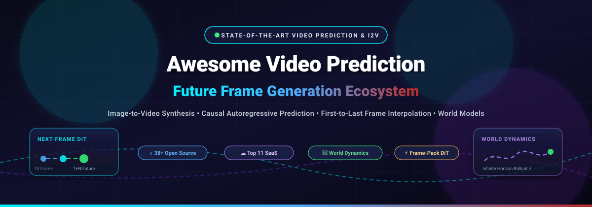
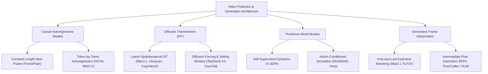

# 🎬 Awesome Video Prediction & Future Frame Generation ⚡

[-cyan.svg)](#-open-source-github-projects)

**A comprehensive, curated index of state-of-the-art Image-to-Video (I2V) foundation models, causal autoregressive video predictors, next-frame extrapolation neural networks, first-and-last keyframe interpolators, and physical world simulation engines.** 🚀🎥

*Last updated: November 2026*

---

## 📑 Table of Contents

- [🌐 Sector Overview & Market Dynamics](#-sector-overview--market-dynamics)
- [☁️ SaaS/Hosted Platforms](#️-saashosted-platforms)
- [💻 Open-Source GitHub Projects](#-open-source-github-projects)
- [🔬 Core Video Prediction Paradigms](#-core-video-prediction-paradigms)
- [📈 Star History](#-star-history)
- [🤝 Support & Sponsorship](#-support--sponsorship)
- [🛠️ How to Contribute](#️-how-to-contribute)
- [📜 Disclaimer & License](#-disclaimer--license)

---

## 🌐 Sector Overview & Market Dynamics

The global generative video and predictive visual AI sector is estimated at **$850M–$950M in 2026** for core video foundation models and is accelerating toward **$3.0B–$5.5B by 2030** (~25% to 33% CAGR), fueled by rapid adoption in cinematic VFX, autonomous robotics simulation, gaming world engines, and automated marketing. 📈

The industry displays a distinct bifurcated structure: **moderately concentrated at the foundational model and compute layer** (where major hyperscalers and top-tier labs like Google DeepMind, Kuaishou, Runway, and Luma command roughly 65% of commercial deployment footprint), yet **highly fragmented across creative workflows and domain-specific applications** (where agile platforms compete dynamically on motion brush steering, character pose re-targeting, first-and-last keyframe interpolation, and sub-second streaming latency). 🎯

---

## ☁️ SaaS/Hosted Platforms

The following hosted platforms provide commercial-grade Image-to-Video generation, first/last keyframe extrapolation, motion brush control, and predictive video engines. Platforms are sorted in descending order by scale, estimated valuation, or corporate parent capitalization. 🏆

| Platform | Starting Tier Pricing | Free Tier Limits | Scale / Valuation | Key Strengths & Video Prediction Features |
| :--- | :--- | :--- | :--- | :--- |
| **[Google Veo (Vertex AI)](https://deepmind.google)** | $0.05 – $0.08 / second (Veo 3.1 Lite 720p/1080p); $0.40 – $0.50 / second (Veo Flagship HD) | 90-day free trial with $300 Google Cloud credits (no permanent free tier; pay-as-you-go thereafter) | **$2.1T+ Market Cap** (Alphabet / Google DeepMind) | Ultra-high definition generative video foundation model offering cinematic temporal consistency, prompt adherence, camera trajectories, and continuous clip extensions. |
| **[Leonardo.Ai (Leonardo Motion)](https://leonardo.ai)** | $12.00 / month ($10.00/mo billed annually) for 8,500 Fast Tokens / month | 150 Fast Tokens / day free forever (resets daily, public creations only) | **$35B – $45B Scale** (Acquired by Canva) | Integrated Leonardo Motion 1.0/2.0 animation engine turning static conceptual art and assets into fluid video clips with customizable motion intensity. |
| **[Kling AI](https://klingai.com)** | $8.80 / month ($6.99 first month promo) for 660 credits / month | 66 credits / day free forever upon login (~6 standard clips/day, watermarked, non-commercial) | **$18.0B Valuation** (Spin-off from Kuaishou) | State-of-the-art cinematic physical motion modeling, first-to-last keyframe transitions, multi-motion brush, and high-fidelity video continuation up to 1080p. |
| **[Runway (Gen-3 / Gen-4)](https://runwayml.com)** | $15.00 / month ($12.00/mo billed annually) for 625 credits / month | 125 one-time credits upon signup (no monthly renewal, watermarked, 5GB storage) | **$5.3B Valuation** (Series E funded) | Category-defining generative video platform featuring Image-to-Video synthesis, Keyframe First/Last interpolation, Multi-Motion Brush, and Camera Control. |
| **[Luma AI (Dream Machine & Ray)](https://lumalabs.ai)** | $30.00 / month ($25.00/mo billed annually) for 10,000 monthly credits | Free evaluation tier with watermarked draft outputs (no permanent daily credit reset; subscription needed for commercial rights) | **$4.0B Valuation** (Series B funded) | High-speed multimodal foundation model specialized in physically plausible real-world dynamics, smooth start/end frame loops, and continuous scene extensions. |
| **[MiniMax (Hailuo AI)](https://hailuoai.video)** | $9.99 – $14.99 / month for ~1,000 credits / month | One-time trial pack of 50–200 welcome credits on signup (watermarked, 768p standard, lowest queue priority) | **~$5.6B Peak Post-IPO Scale** (MiniMax Group) | Renowned for fluid and expressive human movement dynamics, cinematic camera shifts, and consistent character preservation during future frame rollouts. |
| **[Pika Labs (Pika)](https://pika.art)** | $10.00 / month ($8.00/mo billed annually) for 700–900 credits / month | Free plan provides model exploration with 0 free generation credits (requires buying standalone top-up packs from $25) | **$470M – $700M Valuation** (Series B funded) | Intuitive creative studio featuring Pikaframes keyframe transitions, Pikaffects physics modifications, multi-region canvas expansion, and seamless video loops. |
| **[Haiper AI](https://haiper.ai)** | $9.99 / month for basic paid tier; API at $0.05 / second (720p) | 10 video generations / day free forever (resets daily at 00:00 UTC, capped at 720p & 8s) | **$50M – $100M Valuation** ($19.2M total raised) | Perceptual foundation model built by ex-DeepMind researchers offering intuitive Image-to-Video generation, video repainting, and motion steering. |
| **[Viggle AI](https://viggle.ai)** | $7.99 – $9.99 / month for 80 Fast credits / month | 5 relaxed-mode video generations / day free forever (watermarked, 7–15 day temporary storage) | **$19M Series A Scale** (Led by a16z) | Proprietary JST-1 3D-video physics engine providing controllable character motion transfer, video-to-video driving, and physics-consistent movement synthesis. |
| **[DomoAI](https://domoai.app)** | $9.99 / month ($6.99/mo billed annually) for 500 Fast credits / month | 15 one-time credits upon signup (watermarked trial, non-renewing without plan upgrade) | **Private / Bootstrapped** | Focused AI video stylization and animation suite enabling image-to-video conversion, anime/3D motion transfer, and talking character synchronization. |
| **[Kaiber](https://kaiber.ai)** | $10.00 / month (Starter) for 500 credits / month | 5-day trial for $5.00 with 500 trial credits (auto-renews to Creator at $29/mo if not cancelled) | **Private / Seed Stage** | Audio-reactive and artist-centric video generation platform converting keyframe drawings, illustrations, and audio frequencies into rhythmic video continuations. |

---

## 💻 Open-Source GitHub Projects

The following open-source repositories provide source code, weights, inference pipelines, or training recipes for video prediction, future frame synthesis, and generative video modeling. Repositories are sorted in descending order by verified GitHub star counts. 🌟

| Repository | GitHub Stars | Primary Paradigm | Technical Description |
| :--- | :---: | :--- | :--- |
| **[hpcaitech/Open-Sora](https://github.com/hpcaitech/Open-Sora)** |  | Video DiT Suite & I2V | High-performance open-source platform democratizing efficient video production, text-to-video synthesis, image-to-video prediction, and long-horizon video extensions. |
| **[Stability-AI/generative-models](https://github.com/Stability-AI/generative-models)** |  | Latent Video Diffusion (SVD) | Pioneering open-weight latent video diffusion models (SVD and SVD-XT) generating high-resolution 14- and 25-frame future video sequences from a single static image conditioning. |
| **[Wan-Video/Wan2.1](https://github.com/Wan-Video/Wan2.1)** |  | Open Foundation DiT & FLF2V | State-of-the-art open-weight video foundation model suite featuring mainstream I2V-14B, First-to-Last Frame (FLF2V), and efficient consumer-grade 1.3B future frame extrapolation. |
| **[lllyasviel/FramePack](https://github.com/lllyasviel/FramePack)** |  | Constant-Length Frame Predictor | Groundbreaking next-frame prediction architecture by lllyasviel compressing historical context to constant memory, enabling 60-second 30fps continuous video rollout on 6GB GPUs. |
| **[modelscope/DiffSynth-Studio](https://github.com/modelscope/DiffSynth-Studio)** |  | Diffusion Synthesis Engine | Versatile open-source diffusion framework providing fast Image-to-Video generation, long-sequence frame prediction, video stylization, and keyframe-consistent interpolation. |
| **[THUDM/CogVideo](https://github.com/THUDM/CogVideo)** |  | Diffusion Transformer Video Family | Large-scale open DiT video generation family (CogVideoX-5B-I2V, CogVideoX1.5) delivering high-resolution Image-to-Video extrapolation and first/last frame transitions. |
| **[Tencent-Hunyuan/HunyuanVideo](https://github.com/Tencent-Hunyuan/HunyuanVideo)** |  | 13B Video Foundation Model & I2V | Tencent flagship 13B open-weight video foundation model featuring high-fidelity Image-to-Video synthesis, camera motion control, and physical simulation capabilities. |
| **[guoyww/AnimateDiff](https://github.com/guoyww/AnimateDiff)** |  | Temporal Motion Prior Modules | Seminal framework inserting temporal motion modules into personalized image models to generate smooth, temporally coherent frame sequences from initial image states. |
| **[PKU-YuanGroup/Open-Sora-Plan](https://github.com/PKU-YuanGroup/Open-Sora-Plan)** |  | Causal 3D VAE Video DiT | Community-driven open-source reproduction of large-scale video foundation models featuring causal 3D Video-VAE compression and multi-resolution Image-to-Video rollouts. |
| **[Lightricks/LTX-Video](https://github.com/Lightricks/LTX-Video)** |  | Real-Time DiT Video Generation | Ultra-fast open-weight DiT generating high-resolution 30fps Image-to-Video sequences faster than real-time playback on consumer hardware. |
| **[lucidrains/imagen-pytorch](https://github.com/lucidrains/imagen-pytorch)** |  | Cascaded Video Diffusion | Clean, performant PyTorch implementation of cascaded diffusion and spatio-temporal video architectures for continuous frame generation. |
| **[SkyworkAI/SkyReels-V2](https://github.com/SkyworkAI/SkyReels-V2)** |  | Diffusion Forcing & Long Rollout | Infinite-length film generative model combining Diffusion Forcing and causal autoregressive prediction for smooth, unbounded video sequence rollout. |
| **[facebookresearch/SlowFast](https://github.com/facebookresearch/SlowFast)** |  | Spatiotemporal Dynamics Backbone | FAIR core codebase analyzing fast dynamic motions and slow spatial structures, establishing spatiotemporal representations for video prediction. |
| **[Doubiiu/ToonCrafter](https://github.com/Doubiiu/ToonCrafter)** |  | Generative Cartoon Interpolation | Specialized open-source generative frame interpolation model synthesizing smooth intermediate animation frames between two keyframe drawings. |
| **[AILab-CVC/VideoCrafter](https://github.com/AILab-CVC/VideoCrafter)** |  | Open Video Generation Suite | High-quality open-source toolbox featuring VideoCrafter2 and I2V-to-Video conditioning for high-fidelity cinematic video synthesis and frame expansion. |
| **[showlab/Tune-A-Video](https://github.com/showlab/Tune-A-Video)** |  | One-Shot Video Tuning | Pioneering one-shot video generation and motion editing framework transferring temporal dynamics from a single sample to new contexts. |
| **[facebookresearch/jepa](https://github.com/facebookresearch/jepa)** |  | Joint-Embedding Predictive Arch | Meta FAIR self-supervised world model learning foundational physical dynamics by predicting masked future spatiotemporal video features in latent space. |
| **[SandAI-org/MAGI-1](https://github.com/SandAI-org/MAGI-1)** |  | Streaming Autoregressive DiT | Autoregressive DiT predicting chunked future frames sequentially for interactive streaming video generation and indefinite temporal extensions. |
| **[genmoai/mochi](https://github.com/genmoai/mochi)** |  | 10B Asymmetric DiT | Apache 2.0 licensed 10B-parameter Asymmetric Diffusion Transformer (AsymmDiT) by Genmo delivering high-fidelity fluid motion and strong adherence to physical dynamics. |
| **[MooreThreads/Moore-AnimateAnyone](https://github.com/MooreThreads/Moore-AnimateAnyone)** |  | Pose-Guided Character Animation | Open-source implementation generating expressive character animation and future motion rollouts driven by temporal pose sequences. |
| **[jy0205/Pyramid-Flow](https://github.com/jy0205/Pyramid-Flow)** |  | Flow Matching & Pyramid Stages | Training-efficient open-source autoregressive flow-matching video generator producing 10-second 768p Image-to-Video sequences via spatial-temporal pyramid stages. |
| **[google-research/frame-interpolation](https://github.com/google-research/frame-interpolation)** |  | FILM: Large Motion Interpolator | High-performance deep frame interpolation neural network capable of synthesizing smooth in-between frames even with extreme, large-motion pixel displacements. |
| **[DAMO-NLP-SG/Video-LLaMA](https://github.com/DAMO-NLP-SG/Video-LLaMA)** |  | Spatiotemporal Grounded LLM | Multimodal foundation model grounding video understanding and future action anticipation by integrating spatial-temporal visual encoders with LLMs. |
| **[Doubiiu/DynamiCrafter](https://github.com/Doubiiu/DynamiCrafter)** |  | Open-Domain Image Animation | Open-domain still image animator injecting dense image conditioning into video diffusion priors for realistic future motion synthesis and seamless looping. |
| **[tencent/MimicMotion](https://github.com/tencent/MimicMotion)** |  | Confidence-Aware Pose Guidance | Pose-guided human video generation framework synthesizing high-resolution future frames with confidence-aware motion guidance from a single reference image. |
| **[eloialonso/diamond](https://github.com/eloialonso/diamond)** |  | Playable Diffusion World Model | Playable real-time diffusion world model predicting next-frame visual observations and environment physics conditioned on agent actions. |
| **[MCG-NJU/VideoMAE](https://github.com/MCG-NJU/VideoMAE)** |  | Spatiotemporal Masked Encoder | Self-supervised video pre-training paradigm learning spatio-temporal dynamics by reconstructing high-proportion masked frames across video sequences. |
| **[Picsart-AI-Research/StreamingT2V](https://github.com/Picsart-AI-Research/StreamingT2V)** |  | Autoregressive Long-Horizon Video | Autoregressive long-horizon video generation architecture employing short-term and long-term memory blocks to extend videos past 1,200 frames without drift. |
| **[autonomousvision/transfuser](https://github.com/autonomousvision/transfuser)** |  | Multi-Modal Trajectory Predictor | End-to-end predictive transformer integrating LiDAR and camera streams to forecast future ego-vehicle trajectory rollouts and agent interactions. |
| **[tianweiy/CausVid](https://github.com/tianweiy/CausVid)** |  | Sub-Second Causal Video Diffusion | Ultra-fast causal video generation distilled from bidirectional teachers, enabling interactive, low-latency streaming future frame synthesis. |
| **[lucidrains/video-diffusion-pytorch](https://github.com/lucidrains/video-diffusion-pytorch)** |  | Minimalist 3D U-Net Video Prior | Minimal, hackable implementation of spatiotemporal 3D U-Nets and diffusion models for video prediction and next-frame generation research. |
| **[nihui/rife-ncnn-vulkan](https://github.com/nihui/rife-ncnn-vulkan)** |  | Vulkan Frame Interpolator | Fast, cross-platform implementation of Real-Time Intermediate Flow Estimation (RIFE) running frame interpolation smoothly on embedded and consumer GPUs. |
| **[showlab/Show-1](https://github.com/showlab/Show-1)** |  | Hybrid Pixel & Latent Video DiT | Efficient hybrid video generation model combining pixel-space diffusion and latent spatio-temporal generation for smooth motion continuity. |
| **[hzwer/Practical-RIFE](https://github.com/hzwer/Practical-RIFE)** |  | Intermediate Flow Estimation | Seminal real-time video frame interpolation algorithm directly estimating intermediate flows for fluid frame rate upscaling and motion smoothing. |
| **[OpenDriveLab/Vista](https://github.com/OpenDriveLab/Vista)** |  | Driving World Action Model | High-resolution predictive world model extrapolating future autonomous driving visual rollouts conditioned on steering angle, speed, and trajectory commands. |
| **[baaivision/NOVA](https://github.com/baaivision/NOVA)** |  | Non-Quantized Autoregressive Model | Non-quantized causal autoregressive model generating future video frames token-by-token, avoiding codebook information bottlenecks. |
| **[TencentARC/looking-ahead](https://github.com/TencentARC/looking-ahead)** |  | Visual Anticipation Benchmark | Tencent ARC research repository studying visual anticipation, future frame extrapolation, and long-range scene dynamics prediction. |
| **[ali-vilab/i2vgen-xl](https://github.com/ali-vilab/i2vgen-xl)** |  | Cascaded Latent Video Diffusion | Alibaba open research model providing high-resolution cascaded latent video diffusion for smooth image animation and future frame extrapolation. |

---

## 🔬 Core Video Prediction Paradigms

1. **Causal Autoregressive Video Generation:** Frames or latent chunks are predicted sequentially conditioned on past observations. Breakthroughs like `FramePack` compress context histories into fixed-length embeddings, allowing extended generation without memory explosion. ⚡
2. **Spatiotemporal Diffusion Transformers (DiT):** Modern state-of-the-art frameworks (such as `Wan2.1`, `HunyuanVideo`, and `CogVideoX`) compress frames using 3D Causal VAEs and denoise latent video cubes across joint space-time dimensions. 🌌
3. **Diffusion World Models:** Moving beyond aesthetic video clips, predictive world models (like Meta's `V-JEPA`, `DIAMOND`, and `Vista`) forecast future visual observations conditioned on physical dynamics and agent actions. 🚗
4. **Keyframe-to-Video & Generative Interpolation:** Instead of simple linear blend or optical flow warping, models like `Wan2.1 FLF2V`, `FILM`, and `ToonCrafter` generate physically sound in-between motions across extreme temporal shifts. 🎬

---

## 📈 Star History

---

## 🤝 Support & Sponsorship

Thank you so much for exploring this Video Prediction & Future Frame Generation resource! ⭐

If you find this curated ecosystem directory helpful for your research, generative video pipelines, or autonomous world model experiments, please consider:
- **Starring (⭐)** the repository on GitHub to help the community discover it.
- **Forking (🍴)** and contributing new video diffusion models, frame-pack research, or SaaS updates.
- **Sharing (📢)** this directory with computer vision researchers, video artists, and AI engineers.
- **Sponsoring / Buying a Coffee (☕)**: If you would like to support continuous curation and updates, please check out the [Sponsor Dashboard](https://github.com/sponsors/ishandutta2007). Every bit of support makes a tremendous difference! 💖

---

## 🛠️ How to Contribute

Contributions are warmly welcomed! To add or update an entry:

1. **Fork the repository** on GitHub.
2. **Create a descriptive feature branch**: `git checkout -b add-model-name`.
3. **Format your entry**:
   - For SaaS products: Provide concrete starting tier pricing, explicit free tier limits (avoid generic terms like "Usage-based" or "N/A"), and verified valuation/revenue scale.
   - For Open-Source repositories: Ensure the repository link is valid and format the star badge linking directly to the repo's stargazers page.
4. **Submit a Pull Request** with a concise summary of the addition and official reference links.

---

## 📜 Disclaimer & License

- **Disclaimer:** Pricing tiers, free quotas, and corporate valuations represent public and market data recorded as of late 2026. Official vendor terms and API pricing may change over time.
- **License:** Content curated in this repository is distributed under the [Creative Commons Zero v1.0 Universal (CC0-1.0)](https://creativecommons.org/publicdomain/zero/1.0/) public domain dedication.
